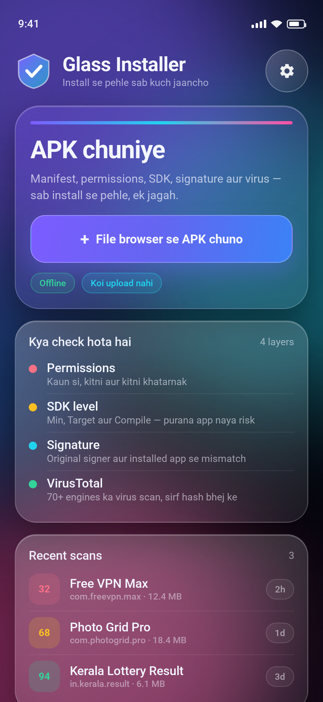
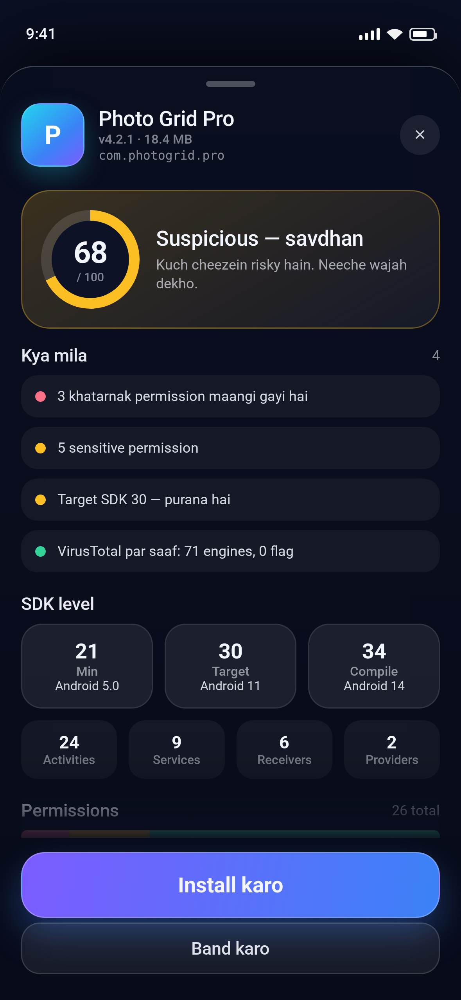
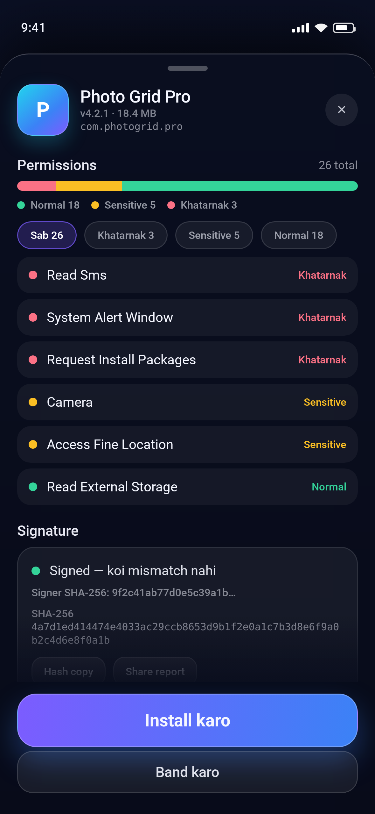
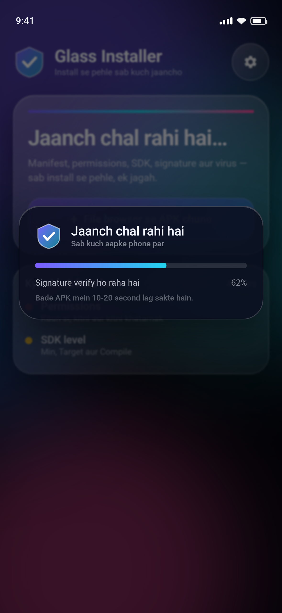
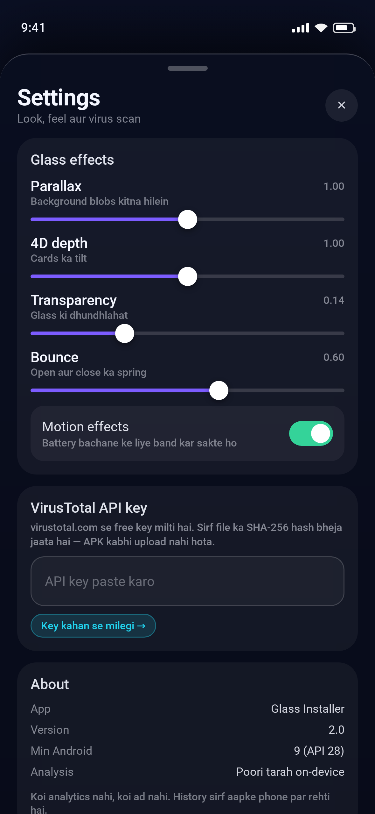

# Glass Installer

**APK ko install karne se pehle poora check karo — permissions, SDK level, signature aur virus — sab ek jagah, sab aapke phone par.**

Android 9+ (API 28) · Kotlin + Jetpack Compose · Material 3 · glassmorphism UI

<p align="center">
  
  
  
</p>
<p align="center">
  
  
</p>

---

## Download

Latest APK: **[GlassInstaller-2.0.apk](https://github.com/technicalnihilist-lgtm/GlassInstaller/releases/download/v2.0/GlassInstaller-2.0.apk)** (22 MB) — sideload karne ke liye
`Settings → Apps → Special access → Install unknown apps` mein browser/file manager ko allow karna hoga.

Har push par GitHub Actions naya APK build karta hai (artifact name: `GlassInstaller-debug`). Saare releases: [releases page](https://github.com/technicalnihilist-lgtm/GlassInstaller/releases).

## Kya check hota hai

| Layer | Kya dekhta hai |
|---|---|
| **Permissions** | Har permission ko Normal / Sensitive / Khatarnak mein grade karta hai, aur batata hai *kyun* khatarnak hai (SMS, Accessibility, Overlay, Device Admin, Install Packages…) |
| **SDK level** | Min, Target aur Compile SDK + Android version name. Purana Target SDK = naye safety rules nahi |
| **Signature** | Signer ka SHA-256, aur agar app pehle se installed hai to signature mismatch (fake update ka sabse bada signal) |
| **Components** | Activities / Services / Receivers / Providers ki ginti, debuggable flag, downgrade detection |
| **VirusTotal** | 70+ engines ka result — **sirf file ka SHA-256 hash bheja jaata hai, APK kabhi upload nahi hota** |
| **Score** | 0–100 ka risk score, har deduction ke saath ek readable wajah |

## Features

- **Score ring + verdict** — 75+ secure, 45–74 suspicious, 45 se neeche khatarnak
- **Permission filters** — Sab / Khatarnak / Sensitive / Normal, aur har row tap karke "ye permission kya kar sakti hai" wali explanation
- **Sticky install bar** — state machine: install → system prompt → success par "Open karo"
- **Share + copy** — poori report share karo ya SHA-256 clipboard mein
- **Recent scans** — last 8 scans, score ke saath (sirf phone par)
- **Glass effects settings** — parallax, 4D tilt, transparency aur bounce slider, motion off toggle (battery ke liye)
- **Zero tracking** — koi analytics, koi ad, koi account

## Install kaise karta hai

`PackageInstaller` session se system installer ko APK deta hai (`REQUEST_INSTALL_PACKAGES` permission ke saath). Play Protect ka dialog aayega — wahi normal flow hai. Koi silent install nahi hota.

## Build karo

```bash
git clone https://github.com/technicalnihilist-lgtm/GlassInstaller.git
cd GlassInstaller
./gradlew assembleDebug        # ya Android Studio mein kholo aur Run dabao
```

APK yahan milega: `app/build/outputs/apk/debug/app-debug.apk`

Requirements: JDK 17, Android SDK 35, Gradle 8.9+.

## Project structure

```
app/src/main/java/com/glass/installer/
├── MainActivity.kt   # app root, background blobs, tilt sensor, sheet routing
├── Home.kt           # hero card, "kya check hota hai", recent scans
├── ReportView.kt     # score ring, findings, SDK, permissions, signature, VirusTotal
├── SettingsView.kt   # glass effect sliders + VirusTotal key
├── Components.kt     # glass card, buttons, pills, rings, gear/logo marks
├── Core.kt           # APK analysis, scoring, PackageInstaller session
├── Cfg.kt            # settings + scan history persistence
└── Theme.kt          # design tokens (colour + type scale)
```

## Notes

- Screenshots `screenshots/` mein hain. Ye app ke design system se render kiye gaye hain — wahi colours, spacing aur copy jo Compose UI use karta hai.
- VirusTotal key optional hai: `virustotal.com → My API key`. Key na ho to baaki saari on-device checks chalti rehti hain.
- Ye ek inspection tool hai, antivirus ka replacement nahi. Unknown source se aaya APK hamesha do baar sochkar install karo.

## License

MIT — see [LICENSE](LICENSE).
